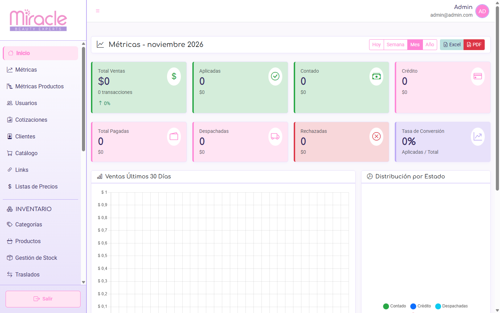
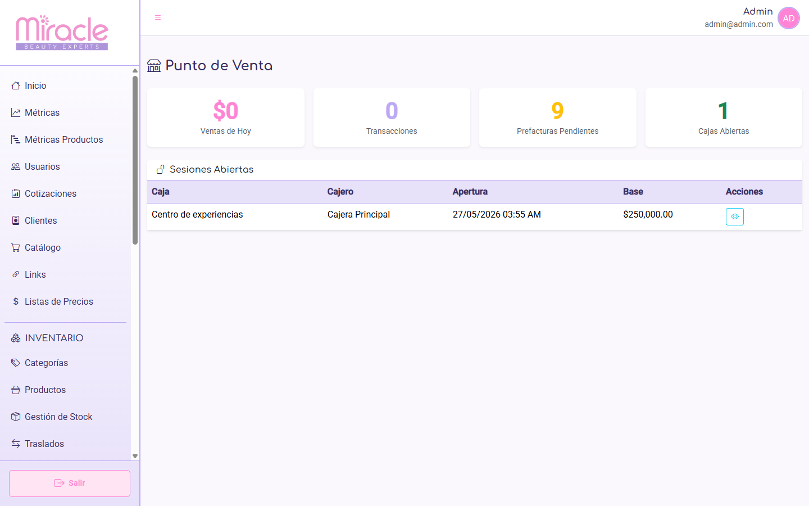
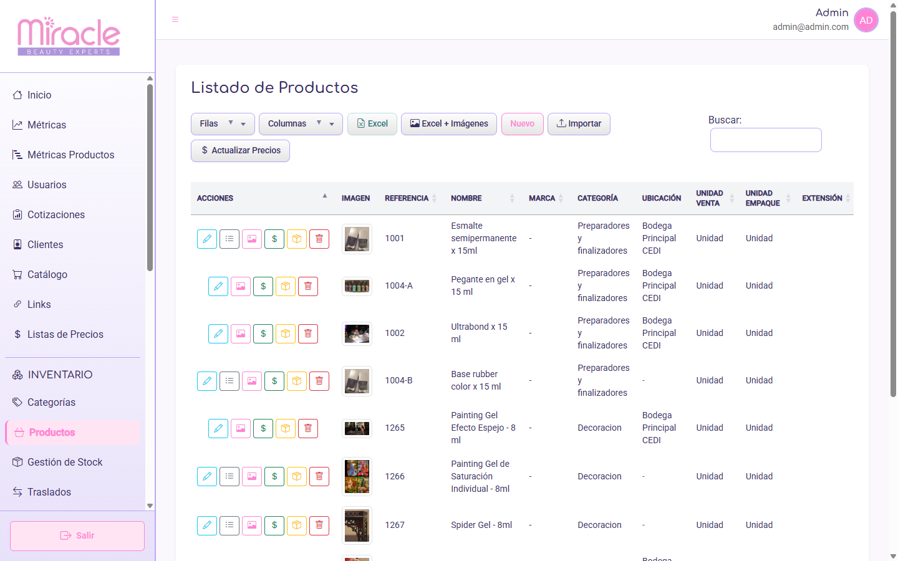
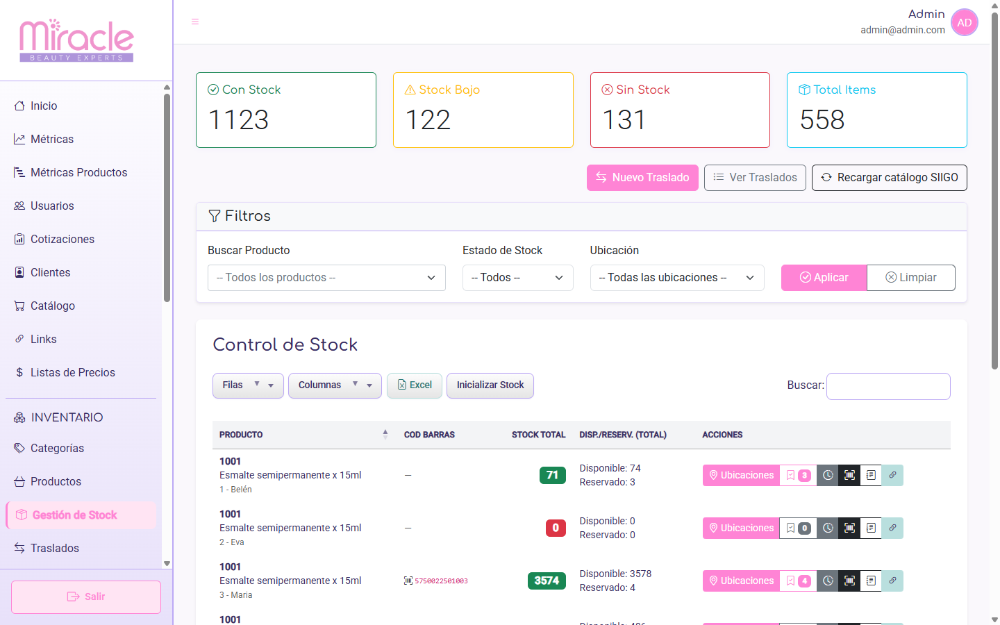
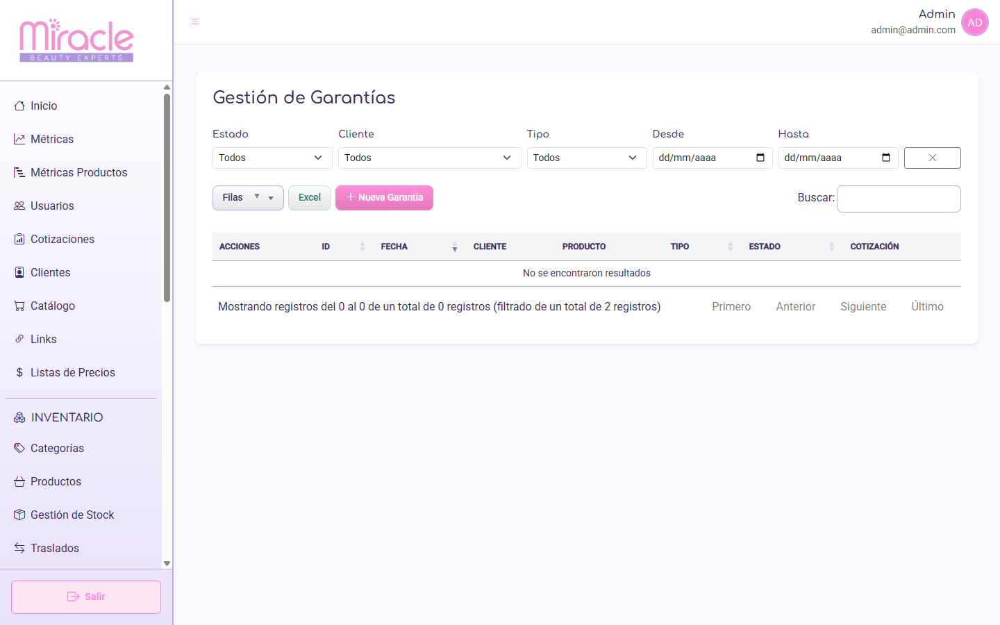
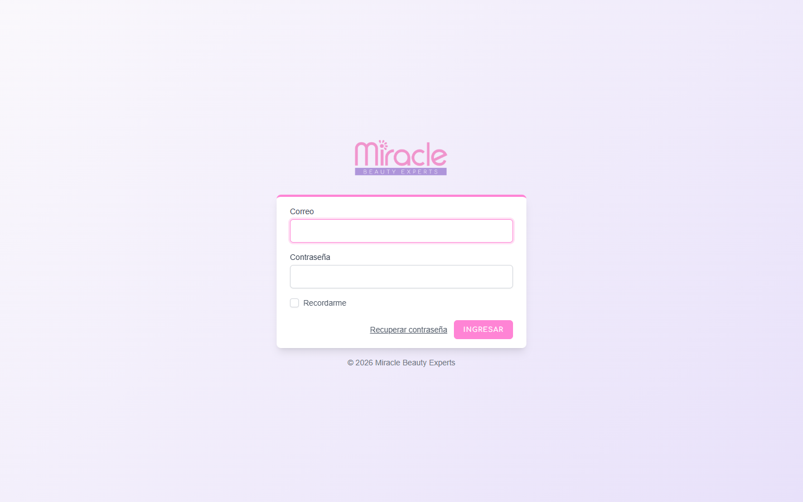

# Miracle — POS, inventario multisede y facturación electrónica

Sistema de punto de venta e inventario para una distribuidora de productos de belleza y uñas con varias tiendas, bodega central e integración con facturación electrónica (SIIGO).



## Contexto

Miracle Beauty Experts vende al por mayor y al detal en varias sedes, ferias y a través de asesoras comerciales. Necesitaban controlar el stock por ubicación, vender en mostrador, cotizar a clientes con listas de precios y emitir facturas electrónicas válidas ante la DIAN sin doble digitación.

## Funcionalidades

- **Punto de venta (PDV)** con apertura/cierre de caja, pagos mixtos (efectivo, transferencia, crédito), impresión directa de ticket y separadores de miles en vivo.
- **Inventario multisede:** stock por bodega/tienda, traslados entre ubicaciones, stock reservado vs. disponible, códigos de barras y alertas de stock bajo.
- **Integración con SIIGO** (facturación electrónica): envío de facturas, reintentos automáticos ante errores transitorios y conciliación de diferencias por redondeo.
- **Cotizaciones y prefacturas** con listas de precios por cliente, aisladas por sede y por vendedora.
- **Ferias:** inventario enviado a eventos, promociones por horario (*happy hour*) y cierre con conteo físico y registro de merma.
- **Garantías y devoluciones parciales**, vales y liberación de productos.
- **Catálogo público** compartible mediante enlaces de acceso.
- **Dashboards y reportes** de ventas y métricas por asesora y producto, exportables a Excel y PDF.
- Importación masiva de productos e imágenes desde Excel y actualización masiva de precios.

## Stack

- **Backend:** PHP 8, Laravel 9, MySQL/MariaDB
- **Autenticación y permisos:** Laravel Breeze + spatie/laravel-permission (roles y permisos)
- **Frontend:** Blade, Livewire, Alpine.js, Tailwind CSS, Bootstrap, DataTables (Yajra), SweetAlert2
- **Documentos:** DomPDF, TCPDF, Laravel Excel / PhpSpreadsheet
- **Integraciones:** API de SIIGO (facturación electrónica Colombia)

## Capturas

**Punto de venta: cajas abiertas y prefacturas**



**Listado de productos**



**Control de stock por ubicación**



**Gestión de garantías**



**Inicio de sesión**



## Instalación local

Requisitos: PHP 8.0+ (con extensiones `gd`, `zip`, `intl`), Composer, Node 18+ y MySQL/MariaDB.

```bash
git clone <url-del-repositorio>
cd miracle
composer install
npm install && npm run build
cp .env.example .env        # configura la conexión a la base de datos
php artisan key:generate
php artisan migrate --seed
php artisan serve
```

La aplicación queda disponible en `http://localhost:8000`. Los seeders crean los roles y datos iniciales (revisa `database/seeders`).

## Notas

- Proyecto desarrollado para un cliente real y desplegado en producción. Las capturas se tomaron en un entorno local; el historial de este repositorio se depuró para no incluir credenciales ni copias de bases de datos.

## Autor

**Santiago Bellaizán** — Desarrollador Full Stack (Laravel · PHP · MySQL · JavaScript)

- GitHub: [@Santibc](https://github.com/Santibc)
